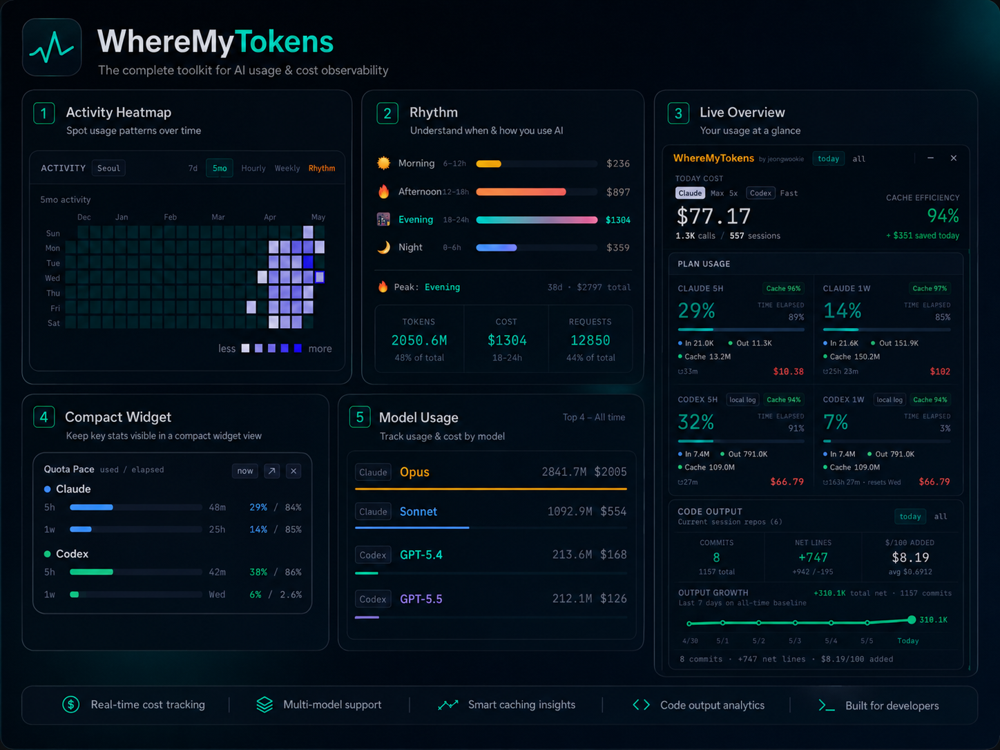
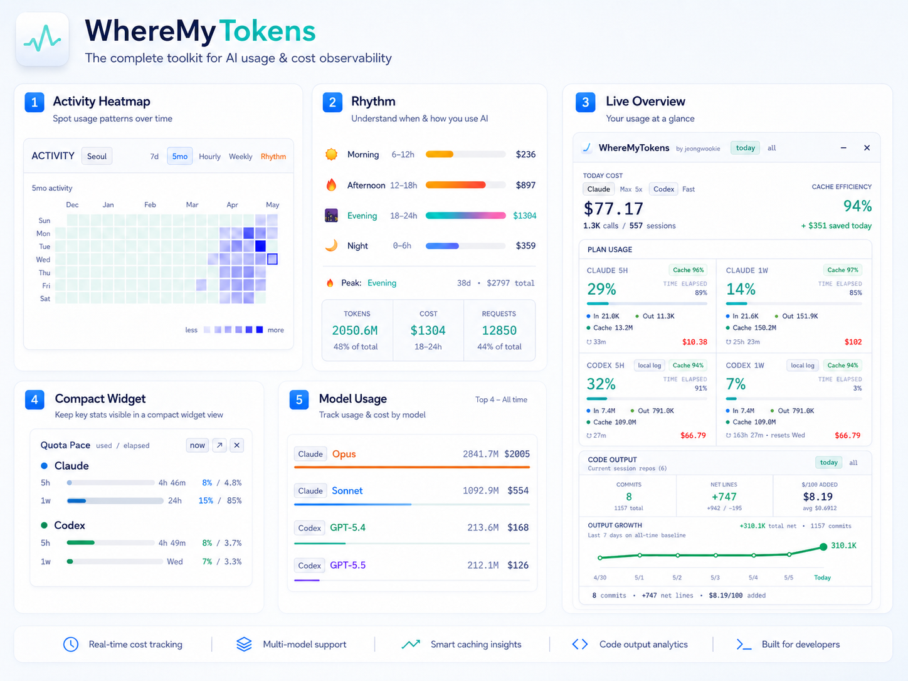

  

<h1 align="center">WhereMyTokens</h1>

  <strong>即時掌握 Claude Code、Codex 與 Antigravity 的 Token 使用情況，就在 Windows 系統匣。</strong>

  
  
  
  
  

  
  
  

  <a href="README.md">English</a> · <a href="README.ko.md">한국어</a> · <a href="README.ja.md">日本語</a> · <a href="README.zh-CN.md">简体中文</a> · <a href="README.es.md">Español</a>

  <a href="#download"><strong>下載</strong></a> ·
  <a href="#first-run">首次使用</a> ·
  <a href="#screenshots">畫面預覽</a> ·
  <a href="https://github.com/jeongwookie/WhereMyTokens-mac">macOS 版本</a>

WhereMyTokens 是一款**以本機資料為主**的桌面應用程式，方便查看 AI 程式開發工具的配額期間、Token 總量、依 API 計價換算的費用估算、快取效率、工作階段、模型使用量、活動趨勢，以及 Git 程式碼產出。

<table>
  <tr><th>深色主題總覽</th></tr>
  <tr><td></td></tr>
  <tr><th>淺色主題總覽</th></tr>
  <tr><td></td></tr>
</table>

> 這個專案由每天使用 Claude Code 的韓國開發者，為了滿足自己的需求而打造。

## 下載

| 平台 | 下載連結 | 適合情境 |
|------|----------|----------|
| Windows 10/11 | **[安裝程式 (.exe)](https://github.com/jeongwookie/WhereMyTokens/releases/download/v1.26.0/WhereMyTokens-Setup.exe)** | 一般安裝，可設定從系統匣自動啟動 |
| Windows 10/11 — 日文介面 | **[日文介面安裝程式](https://github.com/jeongwookie/WhereMyTokens/releases/download/v1.26.0/WhereMyTokens-Setup.exe)** | 與一般安裝程式相同；日文 Windows 可自動選用日文，或到設定中切換 |
| Windows 10/11 | **[免安裝 ZIP](https://github.com/jeongwookie/WhereMyTokens/releases/download/v1.26.0/WhereMyTokens-v1.26.0-win-x64.zip)** | 解壓縮後即可使用，免安裝 |
| macOS Apple Silicon | **[macOS 版本](https://github.com/jeongwookie/WhereMyTokens-mac/releases/tag/mac-v1.1.1)** | 選單列應用程式，提供 DMG／ZIP |

macOS 版本使用獨立的 [WhereMyTokens for macOS 專案](https://github.com/jeongwookie/WhereMyTokens-mac)，並以 `mac-vX.Y.Z` 作為發行版本編號。

下載或安裝即表示同意[終端使用者授權合約](EULA.txt)。

## 首次使用

### 繁體中文介面與新臺幣顯示

- 前往 **Settings → General → Language**，選擇 **繁體中文（臺灣）**。支援辨識繁體中文系統語系；仍可手動選擇語言。
- 本次繁中化包含主要介面、說明頁面、系統匣選單、登入訊息和用量提醒，並保留原有簡體中文語系。
- 在 **設定 → 貨幣** 選擇 **TWD（新臺幣）**。匯率由使用者手動設定，預設 **1 USD = 32 TWD**；不是即時金融市場匯率。
- 貨幣換算僅影響畫面與系統匣顯示，**不會改動原本以 USD 記錄的用量與費用資料**。

感謝 [@lizi1997](https://github.com/lizi1997) 在 [PR #61](https://github.com/jeongwookie/WhereMyTokens/pull/61) 與 #60 的簡體中文貢獻；繁體中文與 TWD 變更由 [@Small-Danny](https://github.com/Small-Danny) 透過 [PR #64](https://github.com/jeongwookie/WhereMyTokens/pull/64) 提出。

### 開始監控

1. 使用 `WhereMyTokens-Setup.exe` 安裝，或將 ZIP 解壓縮後執行 `WhereMyTokens.exe`。
2. 從 Windows 系統匣開啟主控台。
3. 勾選要監控的工具：Claude Code、Codex、Antigravity，可同時啟用。
4. 如需 Claude 官方即時配額資料，可啟用 **Claude Code Integration**，建立官方 `statusLine` 橋接。

## 最新更新

| 版本 | 日期 | 主要變更 |
|------|------|----------|
| **[v1.26.0](https://github.com/jeongwookie/WhereMyTokens/releases/tag/v1.26.0)** | 2026-11-06 | 繁體中文與 TWD 支援、限制 Git 統計並行、工作列右側固定與雙擊開啟、隔離驗證測試並更新安全相依套件 |
| **[v1.25.1](https://github.com/jeongwookie/WhereMyTokens/releases/tag/v1.25.1)** | 2026-09-19 | 將最小化與關閉（X）按鈕固定在右上角；過長的狀態或登入文字不再擠掉視窗控制項。 |
| **[v1.25.0](https://github.com/jeongwookie/WhereMyTokens/releases/tag/v1.25.0)** | 2026-09-19 | 新增簡體中文與 CNY 顯示，修復 Codex 帳戶有 credits 時的配額判斷問題，並更新有漏洞的相依套件。 |
| **[v1.24.6](https://github.com/jeongwookie/WhereMyTokens/releases/tag/v1.24.6)** | 2026-09-11 | 修正 Codex 重複計數，安全校正已驗證的歷史資料，更新 Astra 定價並保留大型 Git 統計資料。 |
| **[v1.24.3](https://github.com/jeongwookie/WhereMyTokens/releases/tag/v1.24.3)** | 8 月 27 日 | 恢復 Windows 上 Antigravity 2.x 的偵測，優先顯示提供者回報的 Gemini 與 Claude/GPT 共用配額群組，並保留舊版逐模型回退機制。 |

升級後，應用程式會在本機檢查歷史用量。如需重建舊版檢查點，初次索引完成後會自動重試；只有確定重複計算的資料會在建立本機備份後校正，其餘資料維持原樣。可在 **設定 → 資料** 查看結果並重新檢查。

[完整版本更新紀錄](https://github.com/jeongwookie/WhereMyTokens/releases)

## 主要功能

- **多工具追蹤**：可勾選 Claude Code、Codex 與 Antigravity，支援任意組合。
- **統一配額資料**：`src/main/providers/` 的適配器將提供者回報的配額轉成標準 Quota Entry，與本機 Token／費用統計分開處理。
- **動態配額卡片**：保留配額範圍、重置時間、已知或未知的期間，以及明確回報的無上限狀態。Antigravity 2.x 優先顯示提供者回報的 `Gemini Models`、`Claude and GPT models` 共用群組，舊版則可回退至逐模型本機 RPC。**未回報的上限不會被推測成 Unlimited。**
- **Claude Code 配額**：優先使用官方 `statusLine` 的 5 小時／7 天資料；缺少新資料時，可使用既有存取權杖進行受限的唯讀相容性查詢。只有提供者實際回報的模型專屬配額才會顯示，不自行推測。
- **Claude 重新登入提醒**：登入過期或遭拒時顯示一次 Windows 通知與應用內操作，開啟官方 `claude auth login` 流程；憑證改變後自動重試，不自行刷新權杖或寫入憑證。
- **工作列迷你配額顯示**：可拖曳，使用兩行呈現標準化的 5 小時／7 天配額，每行可設定 1–3 個區塊；隱藏項目以 `+N` 提示。
- **多語介面**：提供英文、日文、簡體中文與繁體中文（臺灣），可透過 **設定 → 一般 → 語言** 切換。
- **Codex 重置額度**：可在 Plan Usage 顯示獨立的 Reset Credits 項目，並設定完整、精簡或隱藏模式。
- **工作階段**：顯示目前與近期工作階段，資料來自本機提供者紀錄。
- **用量統計**：今日及累計 Token、費用、快取、模型與呼叫次數。
- **活動分析**：活動熱力圖、使用節奏、模型統計與工具使用分布。
- **Git 程式碼產出**：針對持續追蹤的 Git 儲存庫彙整統計，可排除專案，也不依賴近期工作階段是否仍存在。
- **歷史資料保留**：`usage-index.sqlite` 的請求明細保留 8 天、小時精度保留 35 天、每日精度保留 180 天，月統計永久保留。首次索引會提示尚未涵蓋完整歷史；**重設索引**僅能從仍存在的提供者日誌重新建立資料。
- **本機優先**：不提供雲端同步或遙測資料蒐集。

## 隱私與資料安全

WhereMyTokens 讀取本機提供者檔案，只在已啟用的提供者需要即時用量時發出必要請求。它不會上傳工作階段日誌、不進行雲端同步，也不要求使用者貼上 API 金鑰。

Claude 配額優先從本機 Claude Code `statusLine` 取得。缺少最新的配額資料且 Claude Code 憑證可用時，桌面版相容性機制會讀取 `~/.claude/.credentials.json` 中既有的 access token 和方案資訊，並**只將 access token 傳送至固定的 HTTPS 主機 `api.anthropic.com`** 查詢配額。此機制忽略 refresh token、不會刷新憑證，也不寫回憑證檔案。啟動時可能請求一次；同次執行期間至少間隔 15 分鐘，並具備逾時、回應大小限制與 HTTP 429 退避處理。被拒絕的權杖在變更前不會再次嘗試。相容性配額快取會綁定單向權杖識別值，並在回報的重置時間或 30 分鐘上限（以較早者為準）失效。

啟用 Codex 時，即時用量與 Reset Credits 會使用 `~/.codex/auth.json`，直接向 OpenAI／ChatGPT 發出請求。重置額度快取只保留數量、到期時間、取得狀態、來源標籤、雜湊驗證標記與授權檔案修改時間。

Antigravity 僅透過本機 RPC 取得資訊，不使用 Google OAuth、refresh token、Google 雲端用量端點或離線資料庫回退。

詳細來源清單請參閱[隱私與安全文件](docs/privacy-security.md)。

## 其他文件

| 主題 | 連結 |
|------|------|
| 功能詳細說明 | [docs/features.md](docs/features.md) |
| 隱私與安全 | [docs/privacy-security.md](docs/privacy-security.md) |
| 開發與架構 | [docs/development.md](docs/development.md) |
| 發行指南 | [RELEASE.md](RELEASE.md) |

## 授權

MIT
